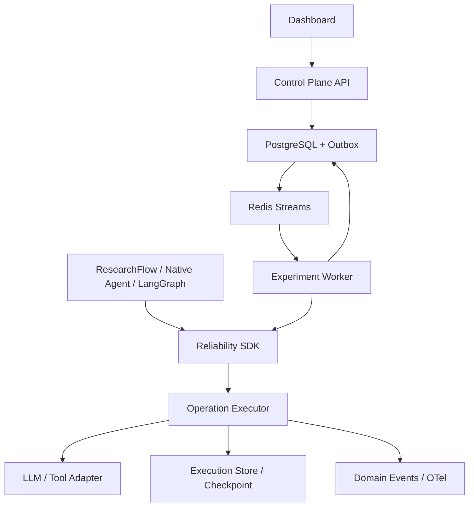

# Agent Reliability Lab：成熟 v1 总体设计

日期：2026-10-15（北京时间）

状态：APPROVED_FOR_IMPLEMENTATION_PLANNING；产品实现尚未开始

批准记录：用户于 2026-10-15 北京时间回复“按设计继续”，批准本设计进入实施计划阶段。

起点：`xxbxxbxxb/agent-reliability-lab`，`main@f66aead6f3591faee8cd3f6ef9205cb58bf2177a`

本文件是对 2026-09-25 总体设计的可交付版本细化，不取代学习进度台账。

## 1. 要完成的事情

为工具调用型 Agent 建立独立的可靠性实验平台。使用者能够接入 Agent，定义故障与恢复策略，执行对照实验，看到失败及恢复过程，在明确的支持范围内恢复中断任务，并用实际结果证明可靠性收益和代价。项目服务于 AI 应用/Agent 求职，也用于学习异步 Python、后端与分布式系统。

用户已经明确的要求：独立仓库；SDK/Runtime + Control Plane；ResearchFlow 保持独立并作为首个外部 SUT；先 Native ReAct 后 LangGraph；先 LLM、Tool、Side Effect 后基础设施；先 Compose 后 Kubernetes；评测是一级能力；优先确定性及状态判分；实现、测试、实际验证都完成才算交付。

本次建议的版本边界：成熟 v1 覆盖原 Phase 1–4，并完成 Phase 0 的 ResearchFlow 接入；提供 LangGraph 的一个受限适配样例，排在 Native 验收之后。Worker 被杀、重复投递、数据库/队列短暂不可用纳入平台自身验收。完整 Kubernetes Chaos、自动扩容、多租户和通用分布式事务保留为 v2，不作为 v1 完成的前提。这是本轮需要用户评审的范围建议。

完成的含义：从安装、运行 SDK 示例、提交实验、查询 Run、检查副作用、重启 Worker、Recorded Replay，到网页对照报告，都有可重复命令和实际结果。文档、接口声明、Mock 成功或页面效果都不能单独证明对应能力完成。

## 2. 当前事实与需要修正的差距

| 项目 | 本次实际观察 | 对设计的影响 |
| --- | --- | --- |
| 工程基础 | Python >=3.11，src layout，Pydantic v2，pytest/Ruff/mypy CI | 继续支持用户 Windows/Anaconda/Python 3.11.3，保持 3.11/3.12 CI |
| 生命周期 | ReliabilityRuntime.run、ExecutionContext.step、内存 TraceSink 已存在 | 演进现有 API；保留“局部失败被处理后 Run 可以成功” |
| 故障策略 | 独立随机数实例、匹配目标、阶段、注入上限 | 保留非匹配不消耗随机数和配额；增加不可变配置及实验调度 |
| 恢复策略 | 能计算 retry/abort/fallback，支持指数退避和 Retry-After | 缺执行器、统一预算、取消、副作用安全判定与真正 fallback |
| 命名 | 代码位于 excution，目标目录应为 execution | 迁移到 execution，旧导入提供薄兼容转发及弃用说明 |
| 持久化与业务闭环 | 尚无 Idempotency Store、Executor、Checkpoint、Replay、平台服务 | 按下述垂直切片实现，不把接口存在写成能力完成 |
| 文档 | README 和 learning-progress 仍记录早期 Task 2 状态 | 新增产品实现台账；学习台账的个人验收不得自动改为完成 |
| 历史 CI | Actions run 38411475673，Python 3.11/3.12 测试、Ruff、mypy 均 success | 这是历史证据，不能替代后续新改动的验证 |
| 本次本地基线 | Python 3.12.14，已有 Pydantic，pytest/Ruff/mypy 未安装；pytest 命令失败于 No module named pytest | 实施阶段先建立隔离环境再重跑；没有本地通过声明 |

历史 CI：<https://github.com/xxbxxbxxb/agent-reliability-lab/actions/runs/38411475673>。

本次未发现仓库中的 AGENTS.md。旧设计与旧 Phase 1A 计划已经读取；原始路线的关键约束保留于本文件。

## 3. 方案比较与选择

| 方案 | 优点 | 代价与适用边界 |
| --- | --- | --- |
| A：Native Runtime + 独立实验平台（推荐） | 与原路线一致；可独立解释和验证幂等、取消、故障、恢复；能接多个 SUT | 必须自己实现明确受限的 Checkpoint、队列及一致性语义 |
| B：直接使用 Temporal 作为主执行引擎 | 可以利用成熟的持久工作流与调度能力 | 运行依赖更重；核心学习容易变成平台配置；仍需要工具端幂等 |
| C：从 LangGraph 应用向外扩展 | Agent 开发较快，可利用框架状态与 Checkpointer | 容易把框架能力和 Lab 能力混在一起，不利于跨框架比较 |

选择 A，参考 B/C 的语义并为其保留适配边界。复用常规数据库、HTTP、观测库，不重写数据库或通用工作流引擎。

## 4. 系统分层与依赖

SDK 核心只依赖 Pydantic、asyncio 与 Protocol；数据库、HTTP、队列、OTel 均为可选 Adapter。Policy 负责决策，Executor 负责执行，Store 负责状态一致性，SUT 负责业务完成判定。

Control Plane 持久化实验配置并返回 Job ID。Worker 执行注册的 SUT，不在 HTTP 请求处理函数里运行长任务。Dashboard 查询真实 API 与实验结果。

两种接入：深度 SDK 可访问步骤、操作语义、Checkpoint；受限 LLM/Tool Proxy 面向无法修改内部代码的 SUT。Proxy 无法自动知道隐藏的 Agent State，不宣称为任意黑盒 Agent 提供恢复能力。

## 5. 核心模型与身份

保留 Run、Step、TraceEvent、Failure、RecoveryAttempt。增加 OperationSpec、Attempt、IdempotencyRecord、Checkpoint、RecordedInteraction、Experiment、Job、BenchmarkResult。

| 身份 | 生命周期及用途 |
| --- | --- |
| task_id | 用户的逻辑任务，可以经历多个 Run |
| run_id | 一次执行实例；新实验/Live Rerun 创建新 Run |
| step_id | 一个 Run 内的逻辑步骤，多次尝试共享一个 Step |
| operation_id | 业务操作的稳定身份，支持跨进程恢复，不以 attempt_id 生成 |
| attempt_id | 一次物理执行尝试，包括主模型及 fallback；每次不同 |
| idempotency_key | SUT namespace + task/operation 的稳定键；重试、重投和恢复复用 |
| request_digest | 对规范化参数、工具版本及业务目标计算摘要；相同 key 不同 digest 必须拒绝 |
| event_id / sequence | event_id 防重复；持久层分配 Run 内递增 sequence，排序不依赖墙上时间 |

Run 为 pending/running/succeeded/failed/cancelled，平台增加 interrupted 以表达进程消失后尚待恢复；恢复创建执行 session，保留 run_id、operation_id 及原先操作结果。Replay 创建独立 replay_id，不改写历史 Run。Step 的 succeeded/failed/cancelled 与 Attempt 结果分开；可恢复的 Attempt 失败不会立即把整个逻辑 Step 标为失败。

所有模型有 schema_version；所有持久时间为 UTC aware。Policy 快照不可变并记录版本/hash。源码 SHA、SUT 版本、数据集 hash、Provider/model、适用时 Prompt 版本都进入实验 manifest。

## 6. 执行器契约

OperationSpec 至少包含 kind/name/operation_id/input、安全语义、timeout、允许的主/备用 Provider、结果校验器。副作用类别为 read_only、idempotent、non_idempotent；工具端能否查结果/去重是单独能力，不能仅靠一个布尔声明获得保证。

一次操作的执行顺序：

1. 校验输入、能力、授权及预算；副作用入口再次做最终授权检查。
2. 获取 operation reservation；已完成则校验摘要并返回已保存结果；相同 key 仍执行中则等待有界结果或返回 in_progress。
3. 创建 Attempt，取得当前执行 generation/lease token。
4. 在指定拦截点应用 FaultDecision，再调用 Adapter；真实耗时边界由 timeout 控制。
5. 校验结果，按声明的事务/工具端协议提交业务结果与幂等记录。
6. 模拟提交后响应丢失时，在提交后、交付前产生故障；不能把副作用提交回滚成“未发生”。
7. 失败生成 Failure；RecoveryPolicy 提出动作；Executor 结合剩余预算、副作用结果及流提交状态批准或拒绝动作。
8. 只提交当前 generation 的有效结果；过期 Attempt 返回值不覆盖新结果。完成或取消时清理自己拥有的资源。

Attempt 临时结果不进入下一次尝试。未知异常默认不可重试；Cancellation 不转成普通 Failure 后重试。Tool 崩溃也需要确认错误类别与安全语义，不能只因 kind=TOOL 就无限重试。

### 6.1 Timeout、Deadline、Retry 与 Fallback

Run 使用总预算，Operation 使用剩余子预算，Attempt 使用单次 timeout。进程内计时采用 monotonic clock；持久化保存 UTC deadline 和剩余预算策略，不持久化 monotonic 绝对值。重启后不得获得新的完整预算；墙钟变化导致不确定时保守终止并记录原因。

max_attempts 统计所有真实主/备用调用，max_fallbacks 另设上限；不得进入备用 Provider 后重置总尝试预算。只有 Executor 拥有重试权，底层 HTTP/SDK 重试关闭或明确计入总预算。

退避为 capped exponential backoff，可选 full jitter；随机源与 FaultEngine 分离。Retry-After 支持秒数与 HTTP-date：等待 max(本地退避, 服务端要求)，若超过剩余 deadline 则终止，不能截短服务端要求后提前调用。

主 Provider 输出校验失败可按策略选择一次受限 fallback，记录原始因果链。多个 Provider 均失败时保留每次错误，不用最后一个异常覆盖全部事实。

### 6.2 取消与流式提交边界

取消传给等待、退避和在途协程，不再启动新 Attempt。设置结束时间，释放 reservation/并发槽/客户端资源；已提交副作用仍保留。远程调用或线程不一定能被撤销，未确认的副作用进入 unknown，不宣称远端已停止。

流开始前允许受限重试/fallback；第一条对外转发的语义内容或 tool-call delta 后禁止透明重放。中途断流必须报告 partial/incomplete 并终止该流；新请求生成新的输出身份。Recorded Replay 复用已记录流事件，不重新请求 Provider。

## 7. 幂等性与副作用真实边界

IdempotencyRecord 状态为 reserved/completed/unknown，包含 key、digest、owner、generation、lease、已提交结果。key 唯一约束及条件更新保证同一时刻只有合法 owner 提交；过期 owner 无法写回。lease 过期不等于非幂等远程操作已停止。

必须区分以下保证：

| 场景 | 可交付的保证 |
| --- | --- |
| 内存示例 | 同进程并发去重；仅用于 M1 演示，不保证进程崩溃后恢复 |
| 同一数据库内的示例工具 | 业务写入、幂等完成记录同一事务；跨进程响应丢失后可安全读取结果 |
| 外部工具支持幂等 key/结果查询 | 由工具端兑现去重；Lab 负责稳定传键、摘要校验、查询与记录 |
| 外部工具无上述能力且结果未知 | 拒绝自动重发，返回 outcome_unknown，等待对账或显式处理 |

不会用“先查本地 cache，再调用外部 API，最后 cache 结果”冒充跨系统 exactly-once。幂等保障不会自动回滚已经提交的外部变化。

## 8. 故障模型与可复现性

保留 BEFORE_CALL 与 AFTER_SUCCESS，增加真实网络 Adapter 的解析/流断开拦截点。至少覆盖 timeout、429、503、malformed output、empty response、tool crash、response lost after commit、duplicate invocation、cancel during backoff、worker interrupted。

FaultDecision 表达被选中的扰动；真正执行注入由 Adapter/Executor 完成。Malformed 必须经过真实输出验证器，response_lost 必须发生在实际提交之后，真实 timeout 用可取消的延迟端点验证。直接抛出的模拟 timeout 与真实计时超时在报告中区分。

实验预先冻结场景计划，基于 scenario_id/task_id/operation_id/phase/attempt_index 独立寻址；不把所有并发调用共享的一个 PRNG 消耗顺序当作跨调度可复现性。原顺序 FaultEngine 的兼容 API 保留，实验模式使用冻结 schedule。记录注入机会、是否实际命中及实际暴露次数。

Seed 只能约束本系统控制的随机量，不能保证线上 LLM 每次产生相同输出。真实模型实验与脚本模型实验分开报告。

## 9. Checkpoint、Resume、Recorded Replay

Checkpoint 是显式状态快照，包含 SUT/schema 版本、下一逻辑 cursor、序列化状态、稳定 operation 身份、已完成结果引用、pending/unknown 操作、fault/recovery 调度位置和预算元数据。只恢复声明支持此协议的 SUT，不序列化 Python 调用栈/协程。

恢复从最后有效 checkpoint 开始：已完成 operation 读取持久结果，未开始的可执行；结果未知的操作先对账。进程死于外部成功和结果记录之间时仍依赖工具端协议，Checkpoint 本身不能填补该窗口。状态版本/hash 不匹配时拒绝恢复并说明原因。

Recorded Replay 在完全禁用网络和业务写入的模式下重新驱动受支持 SUT：用 cassette 复用 LLM/Tool 输出、错误、fault/recovery 决策及流事件。每个输入根据操作身份和参数摘要匹配，缺失、顺序变化、摘要不同即报 replay_mismatch。禁止静默回退到线上。

Replay 不仅显示旧 Trace，还要重新经过受支持 SUT 的控制路径并校验交互序列及最终状态。它验证录制执行路径的一致性，不证明任意新代码或新模型得到同样结果。改模型/Prompt/Policy 的 Live Rerun 是新实验，生成 Diff 并重新承担实际调用成本。

## 10. Control Plane、存储与 Worker

持久化选择 PostgreSQL + SQLAlchemy 2/Alembic；Redis Streams 只传 job_id、协调和心跳；HTTP 采用 FastAPI/Pydantic v2，客户端采用 HTTPX。SQL/HTTP/队列均使用异步接口和显式连接生命周期。

核心表：runs、steps、attempts、failures、recoveries、events、operations、checkpoints、recorded_interactions、experiments、jobs、outbox、benchmark_results、policy_versions。events 使用 (run_id, sequence) 唯一约束；operations 使用 (namespace, key) 唯一约束。JSON payload 存可验证、有限大小的数据，默认移除凭据与认证头。

API 写 Experiment、Job、Outbox 在一个 PostgreSQL 事务内。Dispatcher 从 Outbox 至少一次发布 Redis 消息；重复消息以 job_id 和数据库 CAS claim 去重。只有持久结果提交后 ack。Worker lease + heartbeat + generation fencing 防止旧 Worker 覆盖新 Worker。外部副作用仍服从第 7 节。

Redis 不可用时 Job 保持 queued/outbox pending，重连后由 dispatcher 发布；不能返回“已执行”。Worker 消失后由 sweeper 标记 interrupted/recoverable 并重新入队；PostgreSQL 中的 Job 是恢复依据，不依赖 Redis 内存中是否还存在消息。数据库不可用时禁止提交新的副作用，已经在途且无法确认的操作进入结果未知/对账路径。

取消 API 持久化 cancel_requested，Worker 在步骤边界及协程执行中观察并传播。正常 SIGTERM 停止 claim 新 Job，给在途任务有界宽限，再记录可恢复状态。强杀演示使用独立进程终止，不用普通 Python 异常冒充崩溃。

### 10.1 API 范围

| 方法与路径 | 结果 |
| --- | --- |
| GET /health/live、/health/ready | 进程存活；数据库/必要依赖就绪 |
| POST /api/experiments | 校验冻结配置，幂等创建并返回 202 + experiment/job ID |
| GET /api/experiments、/{id} | 分页列表、状态、四组对比结果 |
| POST /api/experiments/{id}/cancel | 请求取消并返回当前状态 |
| GET /api/runs、/{id} | 分页查询与 Run 详情 |
| GET /api/runs/{id}/events | 按 after_sequence 分页，支持 SSE 重连 |
| GET /api/runs/{id}/failures、/checkpoints | 结构化故障、恢复关联及快照元数据 |
| POST /api/runs/{id}/replays | 创建纯录制重放 Job |
| POST /api/runs/{id}/resume | 通过版本及安全检查后调度恢复 |
| GET/POST /api/policies | 读取/创建不可变策略版本 |
| GET /api/jobs/{id} | Job 状态、attempt、lease 和终止原因 |
| POST /v1/chat/completions | 受限 LLM Proxy，支持文档列出的 JSON/stream 子集 |
| POST /api/tools/{registered_name}/invoke | 注册工具协议；不接收任意脚本或 URL |
| GET /metrics | 可选 Prometheus 指标 |

列表必须有分页和稳定排序；参数错误返回可识别错误码；状态冲突返回 409；API 幂等 key 的不同请求摘要返回冲突。SSE 使用 sequence 作为 event ID，重连先补历史，再追加实时事件。

Proxy 只宣称经兼容测试的协议子集，未知/不支持字段明确拒绝。LLM Provider 由配置选择，不把任意远端地址暴露为公共代理功能。

## 11. 评测设计与验收指标

四组对照：raw、timeout_only、naive_retry、reliable_runtime。它们共用任务、初始数据库快照、SUT/Provider 版本、fault schedule 和判分器，仅保护策略不同。所有组都使用等价测量插桩；不能让 raw 缺日志而把“观测不到重复”写成没有重复。

关键演示为“写入研究笔记/创建模拟订单成功，但回复丢失”。判分读取真实数据库：naive_retry 可能任务成功但重复写入；reliable_runtime 应成功且只有一次业务提交。这个差异是验收期望，不是已经测得的数值。

| 指标 | 固定定义 |
| --- | --- |
| task_success_rate | 确定性/状态/Schema Grader 通过的任务数 / 全部有效任务数 |
| fault_survival_rate | 实际暴露于故障且最终通过的任务数 / 实际暴露任务数 |
| recovery_rate | 故障发生后通过合法恢复成功的逻辑操作数 / 发生可恢复故障的逻辑操作数 |
| duplicate_side_effect_rate | 多于预期的业务提交数 / 预期业务操作数；另报绝对次数 |
| latency | 端到端 wall time，区分真实耗时和虚拟时钟模拟时间；p50/p95 报样本数及 nearest-rank 方法 |
| overhead | 相对配对 baseline 的额外物理调用、重试、fallback、耗时；禁止把缓存命中当上游调用 |
| token/cost | 有 Provider usage 才填；未知为 null；脚本 Provider 标记 simulated，不伪造线上价格 |
| replay_match | 交互匹配率、最终状态摘要、是否发生网络/真实工具写入 |
| trace_completeness | 每个已开始 Run/Step/Attempt 有对应终止或明确 interrupted/unknown 记录，事件可去重排序 |

Smoke 约 10 个具名任务；Regression 50–100 个用例配置；200+ 多 Seed 的 Full profile 在成本可控时运行。优先确定性、状态和 Schema Grader。固定小数据集的统计不能推广为真实大模型可靠性结论。

硬门禁：受支持幂等场景重复提交数为 0；未知副作用自动重发数为 0；取消后新 Attempt 数为 0；Recorded Replay 网络及业务写入数为 0；重投任务不得静默丢失；协议校验失败不能被算成成功。成功率提升和延迟代价必须展示实际测量，不预先承诺某个漂亮百分比。

## 12. 可观测性与 Dashboard

业务执行 Journal/operation/checkpoint 为恢复依据；TraceEvent 是结构化运行事实；OTel Span 是外部观测表示。外部 Collector 不可用不能使已提交业务结果消失，丢失/丢弃观测事件必须计数。不能把必须持久化的 Journal 故障与可降级的外部 Trace Export 故障一并吞掉。

OTel spans 关联 run/step/attempt/provider/tool；Prometheus 展示吞吐、故障、恢复、队列积压、lease 过期和重复提交。高基数字段只放 Trace/日志，不作为无界 metrics label。

React/TypeScript/Vite Dashboard：Overview、Experiments、Runs、Run Detail、Policies。Run Detail 展示逻辑 Step 下的 Attempts、故障注入点、退避、去重命中、结果未知、Checkpoint、Replay Diff。对比页显示四组实际指标、样本量、配置 hash 和下载 JSON 报告。

核心界面文案中文，字段保留必要英文。示例数据明确标记，执行后从 API 读取结果；刷新不创建实验，轮询/SSE 更新不重置滚动位置及选择。无大型营销首页、聊天系统或独立账号系统。

## 13. SUT 与集成边界

1. Native Minimal ReAct：可离线使用 ScriptedProvider，通过结构化 action/observation 驱动真实注册工具；同时提供 HTTP Provider 配置。两种模式明确区分。
2. ResearchFlow：首个外部真实接入；Adapter 映射 LLM/Tool 调用，核心包不导入 ResearchFlow 领域。实施前读取它的实际最新接口，随后用真实源码做集成测试；接口草图不算已接入。跨仓库改动单独分支可评审，不擅自合并。
3. LangGraph：Native 验收后，在可选 extra 中实现一个图示例，映射稳定身份、故障与 Checkpoint；明确选择一层作为重试拥有者，避免框架与 SDK 叠加重试。不宣称适配所有图或全部版本。

## 14. 部署、开发与维护

SDK 安装不带平台依赖。可选 extras 分为 dev/platform/http/otel/langgraph。具体依赖版本在每个实施计划中按官方文档核验并锁定，不根据旧教程猜版本。

本地离线 SDK 示例不需要模型 Key、Docker 或外部账号。完整平台使用 Compose：PostgreSQL、Redis、API、Worker、Dashboard；OTel Collector、Prometheus、Grafana 为 observability profile。执行迁移后才能 ready。提供环境样例但不提交密钥。

默认本机访问；无账号系统的版本不声明为可直接公开运营的多租户服务。SUT/工具通过注册表选择，不能通过 API 上传可执行代码。处理取消、SIGTERM、数据库事务与 HTTP client 关闭。

CI 分核心 Linux/Windows Python 3.11/3.12、离线可靠性回归、真实 PostgreSQL/Redis 服务集成、Dashboard build。上线声称的 Compose 和进程强杀恢复要有实际验收记录；当前环境缺 Docker/服务时准确标记未验证，不能靠 Mock 测试替代。

## 15. 分解为可交付子项目

完整平台需要按依赖顺序形成多个可验证切片，分别写实施计划，不用一个超长 Plan 同时启动所有子系统。

| 里程碑 | 范围 | 退出证据 |
| --- | --- | --- |
| M1 Runtime 闭环 | 兼容迁移、Attempt、执行器、Deadline、取消、故障、重试、fallback、内存幂等、Native SUT、CLI 报告 | 离线一条命令展示 response_lost 的四组差异；真实计时/并发/取消测试；不依赖数据库 |
| M2 持久化与复现 | PostgreSQL adapters、事务示例工具、Checkpoint/Resume、cassette Recorded Replay | 两个独立进程重启；提交后响应丢失不重复；离线 Replay 零外部执行 |
| M3 平台与异步实验 | FastAPI、Outbox、Redis Streams、Worker、lease、cancel、注册工具及 LLM Proxy | 异步提交、重投、强杀、Redis 短断、数据库恢复；实验结果持久存在 |
| M4 观测与产品展示 | OTel、Prometheus/Grafana、Dashboard、固定回归集、Compose、报告与 CI gate | 真实 API 驱动页面；四组实测；Collector 失联不破坏业务；从空环境按文档运行 |
| M5 外部 SUT 验收 | ResearchFlow 实际接入并验收；随后 LangGraph 受限适配；文档及面试材料 | 两个实际集成样例及身份映射测试、适用边界、版本锁定和可重复演示 |

Native 测试夹具先形成，ResearchFlow 作为首个外部集成对象；M1 期间同步核对接口，M5 收口实际跨仓库验收。每个后续子项目在开始前细化其设计/验收，避免把未证实的接口假设一路传播。

当前进入评审的是总蓝图与 M1 的独立详细设计：`2026-10-15-reliability-runtime-core-design.md`。本蓝图的里程碑表是交付分解，不是已经获批的逐文件实施计划。

## 16. 成熟 v1 最终完成清单

- [ ] 现有测试行为保留；兼容迁移有说明。
- [ ] SDK 能运行真实受控故障与恢复闭环。
- [ ] 同一事务/工具端协议支持的副作用场景，跨进程重试仍只有一次提交。
- [ ] 取消、Deadline、Attempt/fallback 总预算、晚到结果均有实际验证。
- [ ] Checkpoint 恢复与 Recorded Replay 覆盖明确声明的 SUT 版本。
- [ ] PostgreSQL/Redis/Worker 平台完成投递、恢复和重复执行验收。
- [ ] Dashboard 展示真实结果，具备四组对照和可下载报告。
- [ ] ResearchFlow 实际接入；Native 之后完成受限 LangGraph 示例。
- [ ] Compose、数据库迁移、观测 profile、CI 和 Windows 开发说明可复现。
- [ ] 发布说明逐项标注 IMPLEMENTED / TESTED / VERIFIED，未运行的部署或真实模型能力明确保留未验证状态。
- [ ] 学习台账与产品实现台账分别记录；AI 完成实现不自动替代用户理解验收。

## 17. 工程经验的落实与证据

以下是结合业务做出的设计选择，不是这些项目对本实现提供的保证。

| 参考 | 本设计落实 |
| --- | --- |
| REA（用户提供的源码分析） | 证据/运行事实稳定身份、冲突检测、模块边界；不复制逆向工具链 |
| LangGraph | Checkpoint 与长期业务事实分开；失败 Attempt 不污染新尝试 |
| LiteLLM | 有界 retry/fallback、全局预算、可观测 Provider 切换；不照搬大型 Router |
| Temporal | 编排恢复和外部副作用幂等分开；承认成功未确认的崩溃窗口 |
| OpenTelemetry / Langfuse | 业务状态与观测表示分开；执行树可关联质量及成本 |
| DSPy | 固定判分数据和回归指标先于 Prompt 优化；本版不引入优化器依赖 |

本次核对的官方资料（2026-10-15）：

- Temporal Activity Definition / Idempotency：<https://docs.temporal.io/activity-definition>
- LangGraph Persistence：<https://docs.langchain.com/oss/python/langgraph/persistence>
- LiteLLM Fallbacks：<https://docs.litellm.ai/docs/proxy/reliability>
- OpenTelemetry Tracing API：<https://opentelemetry.io/docs/specs/otel/trace/api/>

没有宣称本次完整审计所有参考项目源码。具体 Adapter 实施时再次核对对应版本和测试契约。

## 18. 设计自审

范围：完整目标已分解为 M1–M5，第一份详细设计只覆盖 M1。状态语义：内存去重、事务幂等、外部工具幂等、结果未知分别定义，没有把 cache 或 Checkpoint 写成通用 exactly-once。可验证性：每项完成要求对应命令/持久状态/进程实验/报告；当前没有伪造验证结果。兼容性：保留 Python 3.11、历史 API 和用户学习台账边界。待用户评审的是明确范围及设计选择，不是空白需求或待补占位实现。
